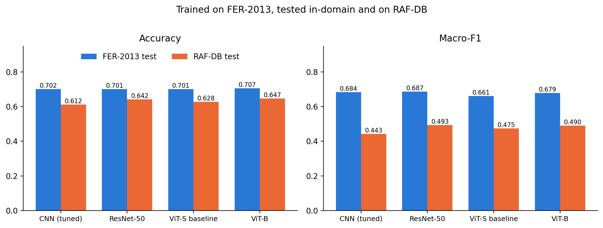
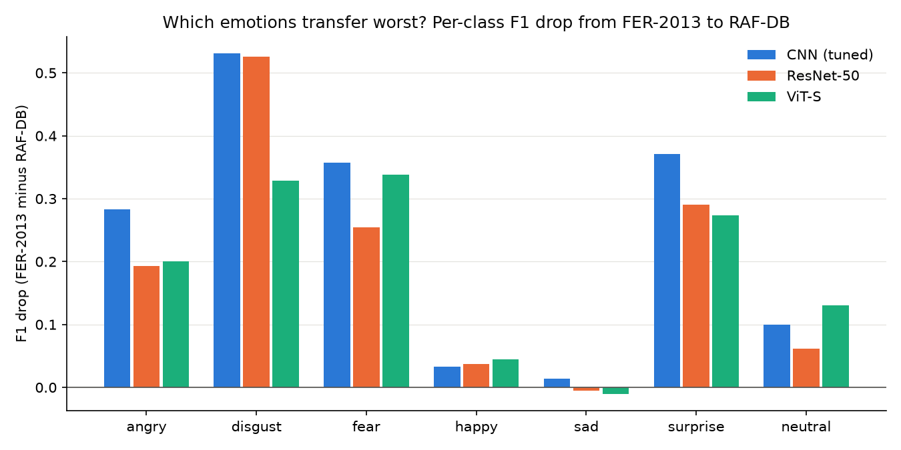
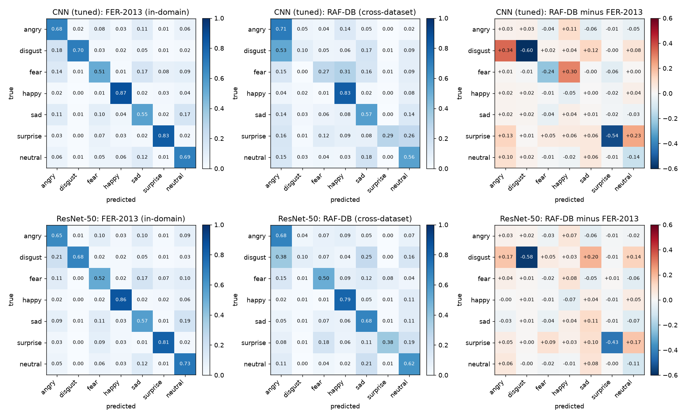
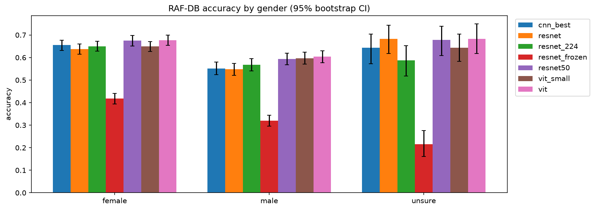
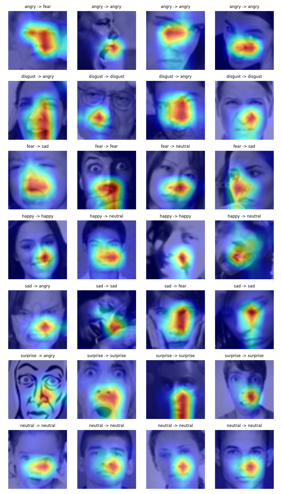
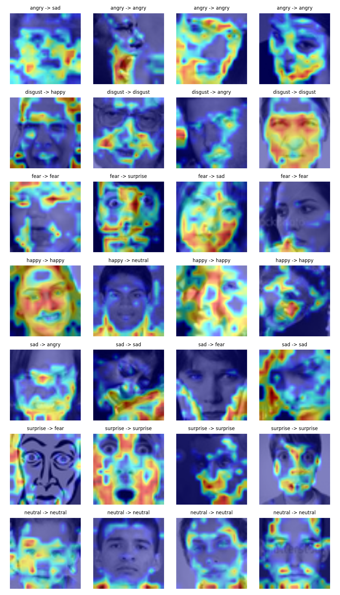

# Facial Expression Recognition: Accuracy, Attention and Bias

**Project P31, Team 31:** Neeraj Parmar, Rakshita K Biradar, Pawan Kushwah

Code and results: https://github.com/Neeraj-NP/P31-facial-expression-recognition

## Abstract

We train three families of facial expression recognition (FER) models on FER-2013, a CNN from scratch, an
ImageNet-pretrained ResNet and a Vision Transformer (ViT), in one shared pipeline, and select one configuration
per family on FER-2013 validation macro-F1. In-domain the three selected models are tied (70.1-70.7% test
accuracy, macro-F1 0.679-0.687). We then test them, unchanged, on the RAF-DB test set. Plain accuracy drops by
6-9 points, but balanced accuracy drops by 15-22, because RAF-DB is 39% happy and happy transfers almost
perfectly while disgust, surprise and fear do not. ResNet-50 and ViT-B transfer better than the tuned CNN
(RAF-DB macro-F1 0.493 and 0.490 against 0.443), but the untuned CNN baseline transfers about as well as either,
and tuning the CNN on FER-2013 made its transfer worse. Using RAF-DB's demographic labels, we find that women
are recognised more accurately than men by every model we trained (7-10 points for the selected models,
p < 0.001). Fine-tuning ResNet-50 on RAF-DB roughly halves that gap, while subgroup-balanced sampling adds
nothing measurable beyond the fine-tuning itself. Grad-CAM shows that the ResNet and CNN focus on one compact
region around the mouth and nose, while the ViT's maps are much more diffuse, yet the two reach the same
accuracy.

## 1. Introduction

Facial expression recognition maps a face image to an emotion category. It is used, or proposed, in
human-computer interaction, driver monitoring, education, healthcare and market research. In most of these
settings the system meets faces it was not trained on: different cameras, lighting, image quality and people.
Two questions therefore matter as much as headline accuracy. **Does the model still work on data from a
different source?** And **does it work equally well for everyone?** A model that is accurate on average but
systematically worse for one gender or age group can harm the people it misreads.

Most FER work reports a single accuracy on the test split of the same dataset it was trained on. That number
answers neither question. We train three model families on FER-2013 [1]: a CNN trained from scratch and two
ImageNet-pretrained architectures. We study them along three axes:

1. **Accuracy.** How do a CNN trained from scratch, an ImageNet-pretrained ResNet [5] and a Vision Transformer
   [6] compare on FER-2013, under one shared training and evaluation pipeline?
2. **Transfer.** How much performance survives when the same models, unchanged, are tested on RAF-DB [2, 3], a
   dataset collected and labelled independently? Which emotions transfer worst, and where do their errors go?
3. **Bias.** Using RAF-DB's gender, race and age annotations, do accuracy gaps between demographic groups exist,
   are they statistically supported, and does subgroup-balanced fine-tuning reduce them?

We also use Grad-CAM [12] to inspect which facial regions each model relies on. For each family we run a small
set of tuning experiments and select one configuration by FER-2013 validation macro-F1, so the three final
models (a tuned CNN, ResNet-50 and ViT-B) are compared on the same footing.

**Contributions.**
- One configuration-driven pipeline (`src/train.py`, `src/evaluate.py`) in which the three model families differ
  only in their YAML config, so the comparisons are not artefacts of different code.
- A cross-dataset evaluation showing that plain accuracy hides most of the transfer loss. Balanced accuracy falls
  by 15-22 points on RAF-DB, against 2.5-9 points for plain accuracy, and the loss is concentrated in disgust,
  surprise and fear. We also find that tuning for in-domain accuracy can make transfer worse.
- A subgroup audit with bootstrap confidence intervals and significance tests. It finds an accuracy gap between
  women and men in every model we trained (7-10 points for the three selected models, p < 0.001). A controlled
  mitigation experiment shows that fine-tuning on target-domain data, not balanced sampling, is what narrows it.

## 2. Related work

**FER datasets and benchmarks.** FER-2013 [1] was released for the ICML 2013 representation learning challenge.
It holds 35,887 48x48 greyscale faces gathered by Google image search and labelled with seven emotions. The
challenge paper estimates human accuracy at about 65 ± 5%, which reflects its label noise. Well-tuned single
CNNs reach about 73% [8], and CNN ensembles about 75% [9]. RAF-DB [2, 3] contains about 30,000 in-the-wild images
from the internet, each labelled by around 40 independent annotators. Its "basic" subset (15,339 images, seven
classes) also provides manual gender, race and age annotations, which makes it one of the few FER datasets that
support a demographic audit. AffectNet [10] is larger but was not used here.

**Architectures.** Deep CNNs replaced hand-crafted features (e.g. LBP, HOG) for FER around 2013-2016; Li and
Deng's survey [4] reviews this shift. ImageNet-pretrained residual networks [5] are a standard transfer-learning
baseline. Vision Transformers [6] split an image into patches and model their relations with self-attention.
Fine-tuned from ImageNet, they match or beat CNNs on many vision tasks. Transformer-based FER models such as
TransFER [7] report over 90% accuracy on RAF-DB when trained on it. We use plain pretrained backbones rather than
FER-specific designs, because our question is how the families compare under identical training, not which
reaches the highest score.

**Cross-dataset generalisation.** Torralba and Efros [13] showed that vision datasets carry a recognisable
"signature", and that models trained on one degrade on another. For FER, the gap comes from differences in
capture conditions, pose and resolution, and also in annotation: Zeng et al. [14] show that FER datasets label
the same expressions inconsistently, and Li and Deng [4] list cross-dataset evaluation as an open problem. We
measure this gap for FER-2013 -> RAF-DB per emotion, and report balanced accuracy alongside accuracy because the
two test sets have very different class mixes.

**Bias and fairness in face analysis.** Buolamwini and Gebru [15] found that commercial gender classifiers had
much higher error rates for darker-skinned women, which started much of the work on demographic auditing in face
analysis. For FER specifically, Xu et al. [11] audited models on RAF-DB and CelebA. They found accuracy
differences across gender, race and age, and compared mitigation strategies including data augmentation and
attribute-aware and disentangled representations. Our audit follows the same idea on RAF-DB. We add bootstrap
confidence intervals and two-proportion z-tests per gap, and a controlled mitigation experiment that separates
the effect of balanced sampling from the effect of fine-tuning on target-domain data.

**Explanation methods.** Grad-CAM [12] weights a layer's activations by the gradient of the class score to
produce a coarse map of the image regions that drive a prediction. It is a standard way to check whether FER
models attend to expressive regions (eyes, brows, mouth) or to background and artefacts.

## 3. Data

### 3.1 FER-2013 (training and in-domain test)

FER-2013 contains 35,887 greyscale 48x48 face images in seven classes. We use the official training set (28,709
images) and hold out a stratified, seeded 10% of it for validation. The validation split is used for checkpoint
and configuration selection. The official public and private test sets (7,178 images together) are used only for
the final in-domain test.

| Emotion | Train | Val | Test | Share of train |
|---|---|---|---|---|
| angry | 3,596 | 399 | 958 | 13.9% |
| disgust | 392 | 44 | 111 | 1.5% |
| fear | 3,687 | 410 | 1,024 | 14.3% |
| happy | 6,493 | 722 | 1,774 | 25.1% |
| sad | 4,347 | 483 | 1,247 | 16.8% |
| surprise | 2,854 | 317 | 831 | 11.0% |
| neutral | 4,469 | 496 | 1,233 | 17.3% |
| **Total** | **25,838** | **2,871** | **7,178** | |

Our exploratory analysis (`notebooks/01_eda.ipynb`, figures in `results/eda/`) found four properties that shape
the rest of the study:

- **Strong class imbalance.** Happy outnumbers disgust 16.6 to 1 in our training split. Disgust has 436 images in
  the official training set, 392 after the validation split. We therefore use an inverse-frequency class-weighted
  loss and report **macro-F1** as the main metric, because accuracy rewards predicting the majority classes.
- **Label noise.** 3,369 images have at least one exact pixel duplicate (1,516 distinct images). In 57 of these
  duplicate groups the copies carry **different labels**, direct evidence of annotation noise. 14 images are
  near-blank (pixel standard deviation below 5), mostly in the training set.
- **Train/test leakage.** 531 test images (7.4% of the test set) also appear in the training or validation data.
  FER-2013 test scores, ours and those in the literature, are therefore somewhat optimistic. So is our validation
  macro-F1, since the random validation split shares duplicates with training. The RAF-DB results are not
  affected.
- **Brightness differs by class.** Mean pixel intensity ranges from 121 (sad) to 146 (surprise). This is a cue a
  model could partly exploit without reading the expression, and one reason to check attention maps.

### 3.2 RAF-DB (cross-dataset test and bias audit)

We use RAF-DB's basic subset: 15,339 aligned 100x100 colour face images with the same seven emotions, split into
12,271 training and 3,068 test images. Its labels use a different class order, which we remap to ours
(`src/datasets.py`). **The RAF-DB test set is never used for training or model selection.** It serves only as
the cross-dataset test set and the population for the bias audit. The RAF-DB training split is used in one place:
the mitigation experiment (Section 5.5), which fine-tunes on it. To keep the input format fixed, every image,
from either dataset and for every model, is converted to greyscale and resized to the model's input size (48x48
for the CNN, 112x112 or 224x224 for ResNet and ViT; 3-channel models receive the grey image replicated). The
cross-dataset gap we measure is therefore not caused by colour.

The test set's class mix differs sharply from FER-2013's:

| Emotion | RAF-DB test n | Share | FER-2013 test share |
|---|---|---|---|
| angry | 162 | 5.3% | 13.3% |
| disgust | 160 | 5.2% | 1.5% |
| fear | 74 | 2.4% | 14.3% |
| happy | 1,185 | 38.6% | 24.7% |
| sad | 478 | 15.6% | 17.4% |
| surprise | 329 | 10.7% | 11.6% |
| neutral | 680 | 22.2% | 17.2% |

Because RAF-DB is 39% happy, a model that is good at happy and poor elsewhere keeps a high accuracy. We therefore
report macro-F1 and balanced accuracy (mean per-class recall) as well.

**Demographic annotations.** Each RAF-DB image has manually annotated gender (female, male, unsure), race
(Caucasian, African-American, Asian) and one of five age groups. The test set is far from balanced:

| Attribute | Groups (test n, share) |
|---|---|
| Gender | female 1,620 (52.8%), male 1,249 (40.7%), unsure 199 (6.5%) |
| Race | Caucasian 2,351 (76.6%), Asian 483 (15.7%), African-American 234 (7.6%) |
| Age | 0-3: 329 (10.7%), 4-19: 486 (15.8%), 20-39: 1,662 (54.2%), 40-69: 502 (16.4%), 70+: 89 (2.9%) |

Small groups (70+ with 89 images, African-American with 234) give wide confidence intervals, which is why every
subgroup result is reported with a 95% bootstrap interval and a significance test rather than as a bare
accuracy. The attribute labels are themselves coarse, perceived categories assigned by annotators. They simplify
gender, race and age, and are a possible source of bias in their own right.

**Licence.** RAF-DB is available for non-commercial research only, and redistribution is not allowed. We
therefore commit only aggregate results (metrics, confusion counts, subgroup tables) and never RAF-DB images,
per-image predictions or RAF-DB Grad-CAM overlays.

## 4. Method

### 4.1 Models

All models predict the same seven classes (angry, disgust, fear, happy, sad, surprise, neutral):

- **CNN (from scratch).** A small VGG-style network (4 convolutional blocks, 64 to 512 channels, about 5M
  parameters) trained from random initialisation on 48x48 greyscale faces. It has no pretrained knowledge of
  natural images and serves as the from-scratch baseline.
- **ResNet-18/50 (transfer learning).** An ImageNet-pretrained `torchvision` ResNet with the final
  fully-connected layer replaced by a dropout and linear head for 7 classes. Inputs are resized to 112x112 (or
  224x224, see tuning below); the greyscale image is replicated to 3 channels and ImageNet-normalised to match the
  input format the pretrained weights expect.
- **ViT (fine-tuning).** An ImageNet-pretrained Vision Transformer with 16x16 patches (`timm`) and a new 7-class
  head, fine-tuned end-to-end at 224x224 (greyscale replicated to 3 channels, ImageNet normalisation). The
  selected model is ViT-B (`vit_base_patch16_224`, about 86M parameters; learning rate 3e-5, weight decay 0.05,
  batch size 32, at most 15 epochs). The ViT-S baseline (`vit_small_patch16_224`, about 22M parameters, learning
  rate 5e-5) is kept as a comparison.

All three share one training script (`src/train.py`) and one evaluation script (`src/evaluate.py`), differing
only through a YAML config in `configs/`, so results are directly comparable and not an artefact of different
training code.

### 4.2 Training setup

Every model is trained with the same recipe, parameterised per model in its config:

- **Optimiser:** AdamW, with per-model learning rate and weight decay.
- **Schedule:** linear warmup for `warmup_epochs`, then cosine decay to 0, stepped every batch.
- **Loss:** cross-entropy with label smoothing (0.1) and inverse-frequency class weights, to counter FER-2013's
  class imbalance.
- **Input format:** every image, from both datasets, is converted to greyscale first; 1 channel for the CNN, and
  replicated to 3 ImageNet-normalised channels for ResNet and ViT.
- **Data augmentation** (training split only): random horizontal flip, affine (rotation, translation, scale),
  brightness and contrast jitter, and random erasing.
- **Mixed precision (AMP)** on GPU, for speed. Training ran on Kaggle T4 GPUs.
- **Model selection:** the checkpoint with the best validation macro-F1 is kept; training stops early if
  macro-F1 does not improve for `early_stop_patience` epochs.

### 4.3 Tuning experiments

Each family has a small sweep that changes one factor at a time against a baseline config. In every family the
configuration is chosen on FER-2013 validation macro-F1, never on RAF-DB. One seed per run.

**CNN** (`results/cnn_tuning.md`): training longer (100 epochs), lighter regularisation, no class weights, and
no augmentation. The selected `cnn_best` combines the longer schedule with lighter regularisation, keeping class
weights and augmentation (validation macro-F1 0.676 against 0.653 for the baseline).

**ResNet** (`results/resnet_tuning.md`), against the ResNet-18 baseline at 112x112:

| Experiment | Change vs. baseline |
|---|---|
| `resnet_frozen` | `freeze_backbone: true`: only the new classifier head is trained (linear probe) |
| `resnet_224` | Input resized to 224x224 instead of 112x112 |
| `resnet50` | ResNet-50 instead of ResNet-18 (batch size halved for memory) |

ResNet-50 has the highest validation macro-F1 (0.681). For the frozen run the backbone is also kept in eval
mode during training: otherwise `model.train()` puts its BatchNorm layers back in training mode and their running
statistics drift away from the pretrained ones (our first frozen run suffered from exactly this and scored about
30% before the fix).

**ViT** (`results/vit_tuning.md`), against the ViT-S baseline (learning rate 5e-5):

| Experiment | Change vs. baseline |
|---|---|
| `vit_small_lr1e5`, `_lr3e5`, `_lr1e4` | Learning rate 1e-5, 3e-5 or 1e-4 |
| `vit_small_lld` | Learning rate 1e-4 with layer-wise learning-rate decay 0.75 (earlier blocks get a smaller step) |
| `vit` | ViT-B instead of ViT-S, learning rate 3e-5, batch size 32 |

ViT-B has the highest validation macro-F1 (0.679, against 0.669 for the best ViT-S run). Freezing the first
blocks (`freeze_blocks`) is implemented but was not run. The layer-decay run builds its optimiser with timm's
`create_optimizer_v2`, which also excludes biases, normalisation parameters, the position embedding and the class
token from weight decay, so that run differs from the baseline in two ways, not one.

### 4.4 Evaluation protocol

Every trained model goes through the same four checks (`src/evaluate.py`, `src/explain.py`):

1. **In-domain test:** accuracy and macro-F1 on the FER-2013 test set.
2. **Cross-dataset test:** the same model, unmodified, evaluated on the RAF-DB test split, which it has never
   seen. We report accuracy, macro-F1 and balanced accuracy, per-class F1, and confusion matrices
   (`src/cross_dataset.py`).
3. **Subgroup bias audit:** RAF-DB's gender, race and age labels let us break the cross-dataset accuracy down by
   group. For each attribute we report accuracy and macro-F1 per group with a 95% bootstrap confidence interval
   (1,000 resamples), and the gap between the best and worst group. We judge a gap two ways: whether the best and
   worst groups' intervals are **separated** (do not overlap; a simple, conservative check, so overlapping
   intervals do not show the gap is zero), and a two-proportion z-test **p-value** between those two groups.
   Neither accounts for the best and worst groups being picked from several, so both flatter a gap somewhat. For
   gender the gap is female vs male; the 199 "unsure" images stay in the per-group tables but are not used for
   the gap. `src/bias_report.py` aggregates the audit across models.
4. **Grad-CAM saliency:** heatmaps for the predicted class on a fixed set of FER-2013 test images, from the last
   convolutional block (CNN, ResNet) and from the last transformer block's first LayerNorm output, reshaped to a
   14x14 patch grid (ViT).

### 4.5 Mitigation experiment

For gender and age, the two attributes with the largest gaps, we fine-tune the trained ResNet-50 further on
RAF-DB's own training split for 10 epochs at a low learning rate (1e-5), using a `WeightedRandomSampler` with
inverse-frequency weights so every group of that attribute is drawn with equal total probability. Every
attribute value counts as a group, so gender's small "unsure" group is sampled about 5x more often than its share
of the data. A control run uses identical fine-tuning with ordinary shuffling, so the effect of balancing can be
told apart from the effect of simply training on RAF-DB. We then repeat the bias audit on each fine-tuned model.

## 5. Results

All numbers come from the committed `results/*/eval_*/` files and are reproducible with
`python -m src.cross_dataset` and `python -m src.bias_report`.

### 5.1 In-domain and cross-dataset performance

| Model | FER-2013 acc / macro-F1 | RAF-DB acc / macro-F1 | Accuracy drop | Macro-F1 drop | Balanced-acc. drop |
|---|---|---|---|---|---|
| CNN baseline (untuned, `cnn`) | 67.6% / 0.648 | 65.1% / 0.480 | 2.5 pts | 0.167 | 16.5 pts |
| **CNN, tuned** (`cnn_best`) | 70.2% / 0.684 | 61.2% / 0.443 | 9.0 pts | 0.241 | 21.7 pts |
| ResNet-18 (`resnet`) | 69.1% / 0.664 | 60.4% / 0.449 | 8.7 pts | 0.215 | 20.4 pts |
| ResNet-18, 224px (`resnet_224`) | 70.3% / 0.675 | 61.3% / 0.465 | 9.0 pts | 0.210 | 19.6 pts |
| ResNet-18, frozen backbone | 34.5% / 0.316 | 36.5% / 0.233 | -2.0 pts* | 0.083* | 12.9 pts* |
| **ResNet-50** (`resnet50`) | 70.1% / 0.687 | 64.2% / 0.493 | 5.9 pts | 0.194 | 15.2 pts |
| ViT-S, untuned baseline (`vit_small`) | 70.1% / 0.661 | 62.8% / 0.475 | 7.4 pts | 0.186 | 18.4 pts |
| **ViT-B** (`vit`) | 70.7% / 0.679 | 64.7% / 0.490 | 6.0 pts | 0.189 | 17.4 pts |

Bold rows are the three selected configurations. \*The frozen model is weak on both datasets, so its small
"drop" is not evidence of good transfer.



- **In-domain the three selected models are tied** (70.1-70.7% accuracy, macro-F1 0.679-0.687, one seed each),
  so we do not rank them.
- **Accuracy understates the transfer loss.** RAF-DB is 39% happy, and happy transfers almost perfectly
  (Section 5.2). Balanced accuracy drops 15-22 points for every fully trained model, against 2.5-9 for plain accuracy.
  Even the CNN baseline, whose accuracy drops only 2.5 points, loses 16.5 points of balanced accuracy.
- **ResNet-50 and ViT-B transfer better than the tuned CNN**: RAF-DB macro-F1 0.493 and 0.490 against 0.443,
  and accuracy drops of 5.9 and 6.0 points against 9.0. ResNet-50 and ViT-B are within noise of each other.
- **This is not a clean "pretraining transfers better" result.** The untuned CNN baseline (not selected) scores
  65.1% / 0.480 on RAF-DB and loses less accuracy and macro-F1 than either pretrained model, and ResNet-18 transfers no better than the
  tuned CNN (8.7 vs 9.0 points). Tuning the CNN on FER-2013 raised its FER-2013 accuracy (67.6% to 70.2%) but
  lowered its RAF-DB accuracy (65.1% to 61.2%); every CNN change that improved FER-2013 left RAF-DB macro-F1 flat
  or lower (`results/cnn_tuning.md`). The ViT sweep shows the same lack of a link: RAF-DB macro-F1 spans only
  0.473-0.504 across the six ViT runs, and the best (ViT-S at learning rate 3e-5) was not the best on validation.

### 5.2 Which emotions transfer, and where the errors go



Per-class F1, FER-2013 -> RAF-DB (change in brackets):

| Emotion | RAF-DB n | CNN, tuned | ResNet-50 | ViT-B |
|---|---|---|---|---|
| angry | 162 | 0.64 -> 0.36 (-0.28) | 0.64 -> 0.45 (-0.19) | 0.63 -> 0.55 (-0.09) |
| disgust | 160 | 0.66 -> 0.13 (-0.53) | 0.68 -> 0.16 (-0.53) | 0.58 -> 0.14 (-0.44) |
| fear | 74 | 0.55 -> 0.19 (-0.36) | 0.54 -> 0.29 (-0.25) | 0.57 -> 0.19 (-0.38) |
| happy | 1185 | 0.88 -> 0.85 (-0.03) | 0.88 -> 0.85 (-0.04) | 0.90 -> 0.87 (-0.03) |
| sad | 478 | 0.57 -> 0.56 (-0.01) | 0.58 -> 0.59 (+0.01) | 0.57 -> 0.60 (+0.04) |
| surprise | 329 | 0.81 -> 0.44 (-0.37) | 0.81 -> 0.52 (-0.29) | 0.81 -> 0.49 (-0.33) |
| neutral | 680 | 0.67 -> 0.57 (-0.10) | 0.67 -> 0.61 (-0.06) | 0.69 -> 0.60 (-0.10) |

- **Happy, sad and neutral transfer** (F1 change of 0.10 or less for all three selected models). These are the
  three largest RAF-DB classes, which is why accuracy holds up.
- **Disgust collapses** in all three (F1 -0.44 to -0.53; recall falls from about 0.70 to 0.10 in each). It has the
  lowest RAF-DB F1 of any emotion for every fully trained model.
- **Surprise and fear lose 0.25-0.38 F1 in every selected model.** Angry is where the models differ most: ViT-B
  keeps it (-0.09), ResNet-50 loses 0.19 and the CNN 0.28. This is where most of the pretrained models' advantage
  over the tuned CNN comes from, not from happy, sad and neutral. Fear is the exception: ViT-B has the largest
  fear drop (-0.38; recall 0.62 to 0.39, where ResNet-50 keeps 0.50).



The confusion matrices (rows normalised; right column is RAF-DB minus FER-2013) show how the errors change. The
largest increases:

| True -> predicted | CNN, tuned (FER -> RAF) | ResNet-50 (FER -> RAF) |
|---|---|---|
| disgust -> angry | 0.18 -> 0.53 | 0.21 -> 0.38 |
| disgust -> sad | 0.05 -> 0.17 | 0.05 -> 0.25 |
| surprise -> neutral | 0.02 -> 0.26 | 0.02 -> 0.19 |
| fear -> happy | 0.01 -> 0.31 | 0.02 -> 0.10 |
| surprise -> angry | 0.03 -> 0.16 | 0.03 -> 0.08 |

1. **Disgust is read as anger (and sadness).** The disgust -> angry confusion already exists in-domain (about
   0.2) and grows on RAF-DB. FER-2013 has only 392 disgust training images in our split (1.5%), so the models'
   notion of disgust is narrow.
2. **Surprise is under-predicted, not mislabelled at random.** Surprise recall falls to 0.29 (CNN), 0.38
   (ResNet-50) and 0.33 (ViT-B) while precision stays high (0.91, 0.83 and 0.94): when the models say "surprise"
   they are usually right, but most surprised faces are called neutral, angry or fear.
3. **The tuned CNN over-predicts anger.** It labels 484 RAF-DB test images angry against 162 true angry faces
   (precision 0.24). The untuned baseline predicts angry 381 times, so tuning made this worse.
4. **Fear -> happy is a CNN problem.** 31% of RAF-DB fear faces are called happy by the CNN, against 10% for
   ResNet-50. Fear has only 74 RAF-DB test images, so these rates are noisy.

Plausible reasons for these classes, not tested here: RAF-DB images are aligned, higher-resolution in-the-wild
photos while FER-2013 is 48x48 and noisier; the two datasets were labelled by different annotators with
different conventions [14]; and the minority emotions have the fewest FER-2013 training examples. Full tables:
`results/cross_dataset_analysis.md`. (ViT-B's confusion counts are not yet committed, so it is missing from the
confusion comparison.)

### 5.3 Subgroup bias audit

An asterisk means the best and worst groups' 95% intervals are separated; p is the two-proportion z-test
between them (Section 4.4).

| Model | Age gap | Gender gap (F-M) | Race gap |
|---|---|---|---|
| CNN, tuned (`cnn_best`) | 15.2 * (p = 0.005) | 10.4 * (p < 0.001) | 5.3 (p = 0.11) |
| ResNet-18 | 18.2 * (p < 0.001) | 9.0 * (p < 0.001) | 3.1 (p = 0.42) |
| ResNet-18, 224px | 9.2 (p = 0.09) | 8.2 * (p < 0.001) | 7.1 (p = 0.07) |
| ResNet-50 | 11.7 (p = 0.03) | 8.1 * (p < 0.001) | 4.7 (p = 0.22) |
| ViT-S (untuned baseline) | 14.6 * (p = 0.007) | 5.4 * (p = 0.003) | 2.5 (p = 0.52) |
| ViT-B (`vit`) | 12.7 (p = 0.02) | 7.3 * (p < 0.001) | 7.6 (p = 0.04) |

Gaps are in accuracy points. Full tables: `results/bias_report/gap_table.csv`.



Per-group accuracy for ResNet-50 (n in brackets): female 67.5% (1,620), male 59.4% (1,249); age 0-3 66.0% (329),
4-19 66.0% (486), 20-39 63.1% (1,662), 40-69 66.7% (502), 70+ 55.1% (89); Caucasian 63.8% (2,351), Asian 67.1%
(483), African-American 62.4% (234). For ViT-B: female 67.7%, male 60.4%; age 0-3 66.9%, 4-19 72.2%, 20-39
61.1%, 40-69 69.1%, 70+ 59.6%; Caucasian 64.4%, Asian 68.3%, African-American 60.7% (same n).

1. **Gender is the one consistent bias.** Every CNN and ResNet model recognises women 8-10 points more accurately
   than men (p < 0.001, intervals separated). Larger or higher-resolution ResNets barely change it (9.0 for
   ResNet-18, 8.2 at 224px, 8.1 for ResNet-50). ViT-B's gap is 7.3 points, still clear (p < 0.001, intervals
   separated); its 0.8-point difference from ResNet-50 is well inside the width of the intervals (men 60.4% vs
   59.4%, women 67.7% vs 67.5%), so we do not read it as ViT-B being fairer. The ViT-S baseline's smaller gap
   (5.4, p = 0.003) came from lower accuracy on women (65.0% vs 67.5% for ResNet-50) rather than better accuracy
   on men; by macro-F1 its gender difference even reverses (male 0.473, female 0.458, overlapping intervals),
   whereas ViT-B's does not (female 0.499, male 0.462).
2. **Age gaps vary widely between models**, from 9.2 (ResNet-18 at 224px) to 21.2 (the untuned CNN), with the
   tuned CNN at 15.2, ResNet-18 at 18.2, ResNet-50 at 11.7, ViT-B at 12.7, ViT-S at 14.6 and the frozen model at
   19.4. In every model except the frozen one, 70+ is the weakest group; it has only 89 images, so its estimate
   is the least certain. We did not test whether the differences between models are significant.
3. **Race gaps are small and mostly unclear, with one borderline case.** No race gap passes the interval check,
   and only ViT-B's reaches p < 0.05: 7.6 points, Asian 68.3% vs African-American 60.7% (p = 0.04). That p-value
   is not corrected for picking the best and worst of three groups, or for the many comparisons across models
   and attributes, and the African-American group has only 234 images, so we treat it as unclear rather than as
   a finding. The other models' race gaps have p above 0.06, which is an absence of evidence, not evidence of
   fairness.
4. **Fairness did not track accuracy.** ResNet-50 and ViT-B are tied on accuracy and transfer, yet differ in
   their gaps (age 11.7 vs 12.7, race 4.7 vs 7.6; differences not tested). Tuning the CNN widened its gender gap
   (8.6 to 10.4) while narrowing its age gap (21.2 to 15.2), so one change moved the two in opposite directions.
   ViT-S and ResNet-50 have the same FER-2013 accuracy but different gaps (gender 5.4 vs 8.1, age 14.6 vs 11.7).

### 5.4 Why is accuracy lower for men?

We checked one explanation on ResNet-50's RAF-DB predictions: that the two genders simply have different emotion
mixes. They do differ (men: 34% happy, 9% angry; women: 44% happy, 3% angry), but re-weighting men's accuracy to
the women's emotion mix raises it only from 59.4% to 61.5%, closing about a quarter of the 8.1-point gap. The rest
comes from lower accuracy *within* emotions, most clearly neutral (54% for men, 69% for women), and also happy,
fear and angry. So for ResNet-50 the model is less accurate on men's faces even within the same emotion. We did
not test why. This check used one model and the test set only (`python -m src.class_mix_check --run
results/resnet50`, which needs the local, uncommitted `predictions.csv`).

### 5.5 Mitigation: subgroup-balanced fine-tuning

ResNet-50 fine-tuned on RAF-DB's training split under three sampling conditions (Section 4.5), re-audited on the
RAF-DB test set. Only the *difference* between a balanced run and the control is evidence that balancing helped,
because fine-tuning on RAF-DB raises RAF-DB accuracy on its own.

| Run | RAF-DB acc | FER-2013 acc | Gender gap (F-M) | Age gap | Race gap |
|---|---|---|---|---|---|
| ResNet-50 (before) | 64.2% | 70.1% | 8.1 (p < 0.001) | 11.7 (p = 0.03) | 4.7 (p = 0.22) |
| Control (no balancing) | 79.4% | 63.4% | 4.1 (p = 0.007) | 10.9 (p = 0.02) | 1.9 (p = 0.34) |
| Gender-balanced | 78.9% | 62.5% | 3.6 (p = 0.02) | 13.3 (p = 0.003) | 3.1 (p = 0.27) |
| Age-balanced | 78.4% | 62.6% | 4.5 (p = 0.004) | 10.9 (p = 0.02) | 3.6 (p = 0.21) |

**Most of the improvement comes from fine-tuning on RAF-DB, not from balancing.** The control alone halves the
gender gap (8.1 to 4.1) and lifts RAF-DB accuracy by 15 points. Gender-balanced sampling reaches a gender gap of
3.6, only 0.5 points below the control and well inside the 2-3 point width of the per-group intervals, at a cost
of 0.5 points of accuracy; the 3.6-point gap is still a gap (p = 0.02). Age-balanced sampling leaves the age gap
exactly where the control has it (10.9). Gender balancing also widened the age gap to 13.3, so improving one
attribute can disturb another. Every fine-tuned model loses about 7 points on FER-2013, the price of adapting to
RAF-DB. We therefore cannot claim that subgroup-balanced sampling reduced bias in this setting; what reduced the
gaps was training on data from the target distribution. Loss reweighting, adversarial debiasing and collecting
more data for under-represented groups were not tried.

### 5.6 Attention (Grad-CAM)

The grids show 4 random FER-2013 test images per emotion, and the same 28 images appear in every model's grid
(`results/cnn_best/`, `results/resnet50/`, `results/vit_small/` and `results/vit/`, under
`explain_fer2013/gradcam_grid.png`).

| ResNet-50 | ViT-B |
|---|---|
|  |  |

1. **CNN and ResNet-50 look at one compact region, usually the lower middle of the face.** ResNet-50 is the most
   regular: nearly every map is a single hotspot over the mouth and nose, whatever the emotion and whether or not
   the prediction is right, and the eyes rarely light up. The CNN is similar but less consistent, with some maps
   on the forehead, chin or the edge of the image.
2. **The ViTs spread their heat much more widely.** ViT-S shows many small patchy hotspots over the whole face.
   ViT-B is more diffuse still, with strong heat on hair, jaw, neck, hands and the image borders in several
   images.
3. **Some wrong predictions have heat away from the face.** For example ViT-B calls a happy face neutral with most
   of the heat along the bottom edge, and ViT-S calls an angry face neutral with heat on the top edge and corners.
4. **One image defeats all four models.** A stylised cartoon face labelled surprise is predicted as angry
   (ResNet-50), fear (CNN and ViT-B) and disgust (ViT-S).
5. **Where the model looks does not track accuracy here.** ResNet-50 has the most compact maps and ViT-B the most
   diffuse, yet their FER-2013 test accuracy is 70.1% and 70.7%.

This is qualitative and rests on 28 images; we did not measure it (for example overlap with facial landmarks, or
deletion and insertion scores). The ViT maps come from a different layer type and resolution (a 14x14 patch grid)
than the convolutional maps, so part of the difference in how diffuse they look may come from the method rather
than the model. Grad-CAM shows where the output is sensitive, not why the model decided: a hotspot on the mouth
does not show that the model understood the expression. Per-group mean maps on RAF-DB (`src/explain.py
--group-by`) were not analysed, so we make no claim about whether the models look at different places for
different groups.

## 6. Discussion

**Accuracy, transfer and fairness are separate questions.** Within the CNN, tuning raised FER-2013 accuracy but
lowered RAF-DB accuracy. ResNet-50 and ViT-B transferred better than the tuned CNN, but pretraining alone did not
explain it: ResNet-18 transfers no better than the tuned CNN, and the untuned CNN baseline transferred as well as
anything. Full fine-tuning clearly beat our frozen-backbone run (34.5% vs 69.1%), though that run is one linear
head trained one way, not a ceiling for frozen features. ViT-B and ResNet-50 are tied in-domain and on RAF-DB, so
in our runs a transformer backbone brought no clear advantage over a CNN-family one, in transfer, fairness or
accuracy, even though the two look at faces very differently.

Fairness followed neither pattern cleanly, as the persistent gender gap shows. The mitigation experiment points
the same way: sampling tricks did little, while exposure to data from the target distribution did most of the
work. This suggests that part of the bias comes from a mismatch between training and target data rather than
from how often each group is seen. A gender gap of about 4 points remains after fine-tuning, so that mismatch is
not the whole explanation.

The headline accuracy hides a lot. Measured by plain accuracy, the untuned CNN loses only 2.5 points on RAF-DB;
measured by balanced accuracy it loses 16.5, and the per-class view shows that disgust, surprise and fear carry
most of the loss. In-domain the tuned CNN is indistinguishable from the other two selected models, yet it
transfers worst of the three and has the largest gender gap; only the second dataset reveals this.

## 7. Limitations

**Data and labels**
- FER-2013 labels come from crowd annotation and include duplicated and conflicting images; 7.4% of its test
  images also appear in training. FER-2013 test accuracy, and the validation macro-F1 used to pick checkpoints and
  configurations, are therefore somewhat optimistic. The RAF-DB numbers are not affected by this leakage.
- An expression label is not a person's felt emotion, and the label conventions of the two datasets only roughly
  match.
- Demographic labels exist only in RAF-DB, so the audit measures bias in cross-dataset transfer. We cannot say
  whether the bias is already present in-domain.
- RAF-DB's demographic labels are coarse and assigned by annotators from appearance: gender has an "unsure" group
  (199 images, left out of the gender gap), race has three groups, age has five buckets. Groups are uneven (70+:
  89 images; African-American: 234), so several intervals are wide, and an overlap or a large p-value is not "no
  bias".

**Statistics**
- One seed per configuration, so differences of about a point between models or runs are within noise. We did not
  compute intervals for differences between models, and did not test whether gaps differ between models.
- We ran many comparisons (three attributes, several models), and the interval check and p-values do not account
  for choosing the best and worst group. ViT-B's race-gap p-value (0.04) in particular is uncorrected and should
  not be read as established.

**Training and tuning**
- Each family's tuning was small and changed one factor at a time on a Kaggle T4. ViT-B was chosen over the best
  ViT-S by a validation margin of only 0.010 macro-F1, which one seed cannot separate from noise; on the FER-2013
  test set the best ViT-S is not worse (macro-F1 0.682 vs 0.679). The best ViT-S learning rate was the highest
  tried, freezing blocks was not run, and the layer-decay run changed weight decay as well as the learning-rate
  schedule (Section 4.3).
- All models see greyscale images only. The ViT weights we start from were pretrained with mean and std 0.5 per
  channel, while every model here uses ImageNet normalisation so that the pipeline is shared; we did not test
  whether this costs accuracy.
- The bias mitigation was run on ResNet-50 only.

**Explanations and scope**
- The attention analysis is qualitative, rests on 28 FER-2013 images and does not cover subgroups.
- The models and the demo notebook (`notebooks/03_demo.ipynb`) are research tools. They are not validated for
  judging real people's emotions, and photos unlike FER-2013 (pose, lighting, age, culture) should be expected to
  do worse.

## 8. Conclusion

| Model | FER-2013 acc / macro-F1 | RAF-DB acc / macro-F1 | Balanced-acc. drop | Gender gap | Age gap | Race gap |
|---|---|---|---|---|---|---|
| CNN, tuned | 70.2% / 0.684 | 61.2% / 0.443 | 21.7 pts | 10.4 | 15.2 | 5.3 |
| ResNet-50 | 70.1% / 0.687 | 64.2% / 0.493 | 15.2 pts | 8.1 | 11.7 | 4.7 |
| ViT-B | 70.7% / 0.679 | 64.7% / 0.490 | 17.4 pts | 7.3 | 12.7 | 7.6 |

Gaps are best minus worst RAF-DB subgroup accuracy in points (gender: female minus male).

- **In-domain, the three selected models are tied** (70.1-70.7% accuracy, macro-F1 0.679-0.687, one seed each).
- **Transfer is where they differ, and accuracy hides it.** All three lose 15-22 points of balanced accuracy on
  RAF-DB, mostly in disgust, surprise and fear. ResNet-50 and ViT-B transfer better than the tuned CNN, but the
  untuned CNN baseline transfers about as well, so the evidence that pretraining itself improves transfer is
  weak; tuning the CNN on FER-2013 clearly hurt its transfer.
- **A gender gap exists in every model**: women are recognised more accurately than men, 7-10 points for the
  selected models (p < 0.001). A larger or different architecture did not remove it. No race gap passes the
  interval check; ViT-B's 7.6-point race gap (p = 0.04, uncorrected) is unclear.
- **What reduced the gap was target-domain data, not architecture or sampling.** Fine-tuning ResNet-50 on RAF-DB
  halved the gender gap (8.1 to 4.1 points) at a cost of about 7 points of FER-2013 accuracy; balanced sampling
  added nothing measurable.
- **Attention maps differ strongly between architectures** (compact for ResNet-50, diffuse for ViT-B), but not in
  a way that predicts accuracy.

In short, accuracy, transfer, fairness and where a model looks are separate properties in our runs. No
architecture was best at all of them, and the clearest gain, a halved gender gap, came from seeing target-domain
data, not from a bigger or different network. Evaluating FER models on a second dataset, per class and per
demographic group, changes which model looks best.

## References

1. I. J. Goodfellow et al. Challenges in Representation Learning: A report on three machine learning contests.
   ICONIP 2013 / arXiv:1307.0414.
2. S. Li, W. Deng and J. Du. Reliable Crowdsourcing and Deep Locality-Preserving Learning for Expression
   Recognition in the Wild. CVPR 2017.
3. S. Li and W. Deng. Reliable Crowdsourcing and Deep Locality-Preserving Learning for Unconstrained Facial
   Expression Recognition. IEEE Transactions on Image Processing, 28(1), 2019.
4. S. Li and W. Deng. Deep Facial Expression Recognition: A Survey. IEEE Transactions on Affective Computing,
   2020 / arXiv:1804.08348.
5. K. He, X. Zhang, S. Ren and J. Sun. Deep Residual Learning for Image Recognition. CVPR 2016.
6. A. Dosovitskiy et al. An Image is Worth 16x16 Words: Transformers for Image Recognition at Scale. ICLR 2021.
7. F. Xue, Q. Wang and G. Guo. TransFER: Learning Relation-aware Facial Expression Representations with
   Transformers. ICCV 2021.
8. Y. Khaireddin and Z. Chen. Facial Emotion Recognition: State of the Art Performance on FER2013.
   arXiv:2105.03588, 2021.
9. C. Pramerdorfer and M. Kampel. Facial Expression Recognition using Convolutional Neural Networks: State of the
   Art. arXiv:1612.02903, 2016.
10. A. Mollahosseini, B. Hasani and M. H. Mahoor. AffectNet: A Database for Facial Expression, Valence, and
    Arousal Computing in the Wild. IEEE Transactions on Affective Computing, 2017.
11. T. Xu, J. White, S. Kalkan and H. Gunes. Investigating Bias and Fairness in Facial Expression Recognition.
    ECCV 2020 Workshops / arXiv:2007.10075.
12. R. R. Selvaraju et al. Grad-CAM: Visual Explanations from Deep Networks via Gradient-based Localization. ICCV
    2017.
13. A. Torralba and A. A. Efros. Unbiased Look at Dataset Bias. CVPR 2011.
14. J. Zeng, S. Shan and X. Chen. Facial Expression Recognition with Inconsistently Annotated Datasets. ECCV 2018.
15. J. Buolamwini and T. Gebru. Gender Shades: Intersectional Accuracy Disparities in Commercial Gender
    Classification. FAT* 2018.

## Appendix: reproducing the results

```powershell
python -m src.train --config configs/cnn_best.yaml --run-name cnn_best
python -m src.train --config configs/resnet50.yaml --run-name resnet50
python -m src.train --config configs/vit.yaml --run-name vit
python -m src.evaluate --run results/cnn_best --dataset fer2013
python -m src.evaluate --run results/cnn_best --dataset rafdb
python -m src.cross_dataset
python -m src.bias_report --runs results/cnn_best results/resnet50 results/vit
python -m src.explain --run results/cnn_best --dataset fer2013
```

Training was done on Kaggle T4 GPUs with `notebooks/kaggle_train.ipynb`. RAF-DB must be obtained from its
authors under their licence; it is not included in the repository.
