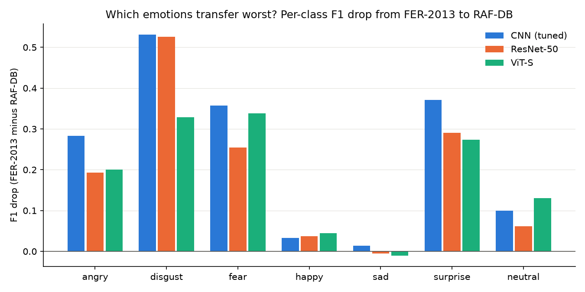
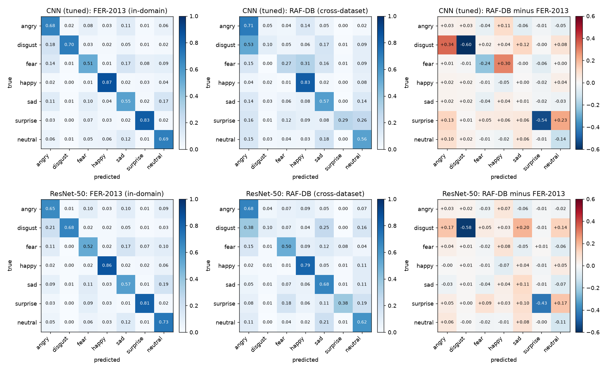

# Cross-dataset analysis: FER-2013 -> RAF-DB (#9, #13)

Every model is trained on FER-2013 only and tested, unchanged, on the RAF-DB test set (3,068 images).
RAF-DB is never used for training or model selection. All tables and figures are rebuilt by

```powershell
python -m src.cross_dataset
```

which writes `results/cross_dataset/`: `cross_dataset.md` / `.csv` (overall table), `per_class.csv`,
`per_class_drop.png`, `confusion_compare.png` and `confusion_shift.csv`. ViT rows and bars appear
automatically once `results/vit_small/` has both evaluations.

## 1. Overall: accuracy hides most of the transfer loss

| Model | FER-2013 acc / F1 / bal. acc | RAF-DB acc / F1 / bal. acc | Acc drop | F1 drop | Bal. acc drop |
|---|---|---|---|---|---|
| CNN baseline (`cnn`) | 67.6% / 0.648 / 67.5% | 65.1% / 0.480 / 51.0% | 2.5 | 0.167 | 16.5 |
| **CNN, tuned (`cnn_best`)** | 70.2% / 0.684 / 69.2% | 61.2% / 0.443 / 47.5% | 9.0 | 0.241 | 21.7 |
| ResNet-18 (`resnet`) | 69.1% / 0.664 / 68.4% | 60.4% / 0.449 / 48.0% | 8.7 | 0.215 | 20.4 |
| ResNet-18, 224px (`resnet_224`) | 70.3% / 0.675 / 69.6% | 61.3% / 0.465 / 49.9% | 9.0 | 0.210 | 19.6 |
| ResNet-18, frozen backbone | 34.5% / 0.316 / 37.8% | 36.5% / 0.233 / 24.9% | -2.0 | 0.083 | 12.9 |
| **ResNet-50 (`resnet50`)** | 70.1% / 0.687 / 68.7% | 64.2% / 0.493 / 53.5% | 5.9 | 0.194 | 15.2 |
| ViT-S, untuned (`vit_small`) | 70.1% / 0.661 / 69.1% | 62.8% / 0.475 / 50.7% | 7.4 | 0.186 | 18.4 |

Bold rows are the configurations selected on FER-2013 validation macro-F1; ViT-S is a single untuned
baseline run. Balanced accuracy is the mean per-class recall.

- **Accuracy understates the loss.** RAF-DB's test set is 39% happy, and happy is the one class that
  transfers almost perfectly (section 2). Measured by balanced accuracy, every trained model loses
  15-22 points, not the 2.5-9 points accuracy suggests. Even the CNN baseline, whose accuracy drops
  only 2.5 points, loses 16.5 points of balanced accuracy.
- **Of the two selected models, ResNet-50 transfers better** on every measure (balanced-accuracy drop
  15.2 vs 21.7 points). The untuned CNN baseline transfers about as well (16.5), so this is not a clean
  "bigger pretrained model transfers better" result (see `report/results_and_discussion.md`).
- **ViT-S sits in between** (balanced-accuracy drop 18.4): it matches ResNet-50 on FER-2013 accuracy but
  scores lower on RAF-DB and loses more balanced accuracy (its macro-F1 drop, 0.186, is slightly smaller
  than ResNet-50's 0.194). With one untuned run, this does not show how a tuned ViT would compare.
- The frozen-backbone model's small drop reflects that it is weak on both datasets, not that it transfers well.

## 2. Which emotions transfer worst?



Per-class F1, FER-2013 -> RAF-DB (change in brackets):

| Emotion | RAF-DB n | CNN, tuned | ResNet-50 | ViT-S (untuned) |
|---|---|---|---|---|
| angry | 162 | 0.64 -> 0.36 (-0.28) | 0.64 -> 0.45 (-0.19) | 0.62 -> 0.42 (-0.20) |
| disgust | 160 | 0.66 -> 0.13 (-0.53) | 0.68 -> 0.16 (-0.53) | 0.51 -> 0.18 (-0.33) |
| fear | 74 | 0.55 -> 0.19 (-0.36) | 0.54 -> 0.29 (-0.25) | 0.53 -> 0.19 (-0.34) |
| happy | 1185 | 0.88 -> 0.85 (-0.03) | 0.88 -> 0.85 (-0.04) | 0.89 -> 0.85 (-0.04) |
| sad | 478 | 0.57 -> 0.56 (-0.01) | 0.58 -> 0.59 (+0.01) | 0.58 -> 0.59 (+0.01) |
| surprise | 329 | 0.81 -> 0.44 (-0.37) | 0.81 -> 0.52 (-0.29) | 0.81 -> 0.54 (-0.27) |
| neutral | 680 | 0.67 -> 0.57 (-0.10) | 0.67 -> 0.61 (-0.06) | 0.68 -> 0.55 (-0.13) |

- **Happy, sad and neutral transfer** (F1 change of 0.10 or less for the two selected models). These are the three
  largest RAF-DB classes, which is why accuracy holds up.
- **Disgust collapses** in both selected models (F1 -0.53; recall 0.70 -> 0.10 for the CNN, 0.68 -> 0.10 for
  ResNet-50). It has the lowest RAF-DB F1 of any emotion for every fully trained model, and the largest
  drop for all of them except ViT-S, where fear drops slightly more (-0.34 vs -0.33). (The frozen-backbone
  run is weak everywhere and follows neither pattern.)
- **Surprise, fear and angry also lose 0.19-0.37 F1.** ResNet-50 loses less than the CNN on each of
  them; that, not happy/sad/neutral, is where its better transfer comes from.
- **ViT-S follows the same pattern.** Its smaller disgust drop (-0.33) is because it starts lower on
  FER-2013 (0.51); on RAF-DB it ends at about the same level (0.18). Its neutral F1 drop (-0.13) is the
  largest of any model. ViT-S is not in the confusion comparison below until its `confusion.csv`
  files are committed (`python -m src.cross_dataset --from-predictions` on the machine with its
  `predictions.csv`).

## 3. How the errors change (confusion matrices)



Rows are true labels, normalised to sum to 1. The right column is RAF-DB minus FER-2013: red cells are
confusions that become more common on RAF-DB. The largest increases (`confusion_shift.csv`):

| True -> predicted | CNN, tuned (FER -> RAF) | ResNet-50 (FER -> RAF) |
|---|---|---|
| disgust -> angry | 0.18 -> 0.53 | 0.21 -> 0.38 |
| disgust -> sad | 0.05 -> 0.17 | 0.05 -> 0.25 |
| surprise -> neutral | 0.02 -> 0.26 | 0.02 -> 0.19 |
| fear -> happy | 0.01 -> 0.31 | 0.02 -> 0.10 |
| surprise -> angry | 0.03 -> 0.16 | 0.03 -> 0.08 |

1. **Disgust is read as anger (and sadness).** The disgust -> angry confusion already exists in-domain
   (about 0.2) and grows on RAF-DB. FER-2013 has only 436 disgust images in its official training set (392 after our validation split, 1.5%), so the
   models' notion of disgust is narrow, and RAF-DB's disgust faces mostly fall outside it.
2. **Surprise is under-predicted, not mislabelled at random.** On RAF-DB, surprise recall falls to
   0.29 (CNN) / 0.38 (ResNet-50) while precision stays high (0.91 / 0.83): when the models say
   "surprise" they are usually right, but most surprised faces are called neutral, angry or fear.
   The CNN predicts surprise only 105 times, against 329 truly surprised faces.
3. **The CNN over-predicts anger on RAF-DB.** It labels 484 test images angry against 162 true angry
   faces (precision 0.24), drawing from disgust, surprise, neutral and sad. Tuning made this worse: the
   untuned baseline predicts angry 381 times. This is one concrete way the tuned CNN's FER-2013 gains
   failed to carry over.
4. **Fear -> happy is a CNN problem.** 31% of RAF-DB fear faces are called happy by the CNN, against 10%
   for ResNet-50, which keeps fear recall almost unchanged (0.52 -> 0.50). Fear has only 74 RAF-DB test
   images, so these rates are noisy.

Why these classes? Plausible explanations, not tested here: RAF-DB images are aligned, higher-resolution
in-the-wild photos while FER-2013 is 48x48 and noisier (colour is not a factor: every model receives
greyscale input from both datasets); the two datasets were labelled by different
annotators with different conventions; and the minority emotions (disgust, fear) have the fewest
FER-2013 training examples, so the models learn the least general features for them.

## Caveats

- One training seed per configuration. Differences of a few F1 hundredths between models are within noise.
- Small RAF-DB classes (fear 74, disgust 160, angry 162) make their per-class rates uncertain.
- All `confusion.csv` files, ResNet-50's included, are exact counts built from the evaluation
  predictions. New evaluations write them directly (`src/evaluate.py` now saves `confusion.csv`).
- Per-image predictions are not committed (RAF-DB licence); the confusion counts are aggregate.
